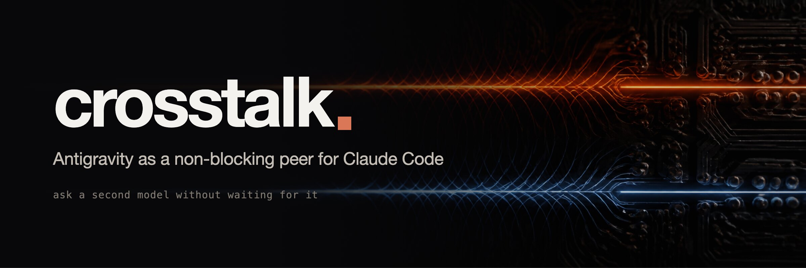

<div align="center">



Ask a second model without watching a spinner. Keep the thread across calls. Send the answer to whichever of your sessions actually needs it.

[](LICENSE)
[](https://code.claude.com/docs)
[](https://antigravity.google)

English · [Español](README.es.md) · [中文](README.zh-CN.md)

</div>

---

## The problem

Every Claude-to-Gemini bridge available today is **blocking**. Claude shells out to `agy`, and then everyone waits — you, the model, the terminal — while a second model reads a codebase for four minutes. Delegation that costs you four minutes of wall clock is not delegation. It is a slow tool call.

crosstalk fixes the shape of the interaction, not the plumbing:

- **Non-blocking.** Fire the call into the background. Claude keeps working and is notified when it exits. The answer arrives as an interruption you handle, not a wait you endure.
- **Threaded.** Every call can resume a named Gemini conversation, so the follow-up does not re-explain the problem.
- **Routable.** Claude Code 2.1.224 added cross-session messaging. crosstalk uses it: the answer can land in the session that needs it, not the one that happened to ask.
- **Accounted.** Every call records what it cost. `stats` tells you how much work you actually moved off your Claude context.

## How it compares

Prior art is real and worth using — this is not a replacement for all of it.

| | crosstalk | [antigravity-for-claude-code](https://github.com/yuting0624/antigravity-for-claude-code) | [claude-code-agy-CLI-skill](https://github.com/SafeMantella/claude-code-agy-CLI-skill) |
|---|---|---|---|
| Delegation | non-blocking | blocking sub-agent | blocking |
| Conversation continuity | named threads, resumed | per-invocation | per-invocation |
| Cross-session routing | yes, via `SendMessage` | — | — |
| Token accounting | ledger + `stats` | — | — |
| Model routing across the SDLC | — | yes | — |

If you want opinionated model routing across the software lifecycle, use `antigravity-for-claude-code`; it is a good project and does something crosstalk does not try to do. Use crosstalk when the thing you want is a peer you can ask without stopping.

## Install

```
/plugin marketplace add obeskay/crosstalk
```
```
/plugin install crosstalk@crosstalk
```

Two separate prompts — the install does not work if you paste them together.

Or use the skill without the plugin: copy `skills/crosstalk/` into `~/.claude/skills/`. The script ships inside the skill directory, so that one copy is the whole install.

Either way, **start a new session afterwards** — Claude Code loads skills at session start.

## Requirements

- **Claude Code 2.1.224+** for cross-session messaging. Earlier versions still get non-blocking delegation and threads; only the routing needs it. macOS and Linux — the messaging feature is not on native Windows.
- **[Antigravity CLI](https://antigravity.google)** (`agy`) on your `PATH`, signed in.
- **`python3` or `node`** to read `agy`'s JSON. One of them is already on your machine.

## Use

You do not call this yourself. Ask Claude:

```
ask Gemini whether this retry loop can double-charge
```
```
get a second opinion on the migration plan, don't wait for it
```
```
have Gemini sweep the repo for hardcoded URLs and tell the session in my other terminal
```

Directly, if you want:

```bash
crosstalk.sh ask "Does this retry double-charge on 429?" --thread payments
crosstalk.sh ask "What about on 503?" --thread payments   # remembers
crosstalk.sh stats
crosstalk.sh threads
crosstalk.sh reset payments
```

Flags: `--thread NAME`, `--model M`, `--effort low|medium|high`, `--timeout DUR` (default `10m`).

## How it works

```
   your Claude session                          Antigravity
  ┌────────────────────┐                     ┌───────────────┐
  │  crosstalk skill   │  background call    │  agy -p       │
  │                    │ ──────────────────► │  --output-    │
  │  keeps working ────┼─ ─ ─ ─ ─ ─ ─ ─ ─ ─  │    format json│
  │                    │ ◄────────────────── │               │
  └─────────┬──────────┘   notified on exit  └───────────────┘
            │                                        ▲
            │ SendMessage                            │ --conversation <id>
            ▼                                        │
  ┌────────────────────┐                    ┌────────┴────────┐
  │  your other        │                    │  thread state   │
  │  Claude session    │                    │  (local, plain) │
  └────────────────────┘                    └─────────────────┘
```

`agy -p --output-format json` returns `conversation_id`, `status`, `response` and `usage`. crosstalk stores the conversation id per thread name and passes it back with `--conversation` on the next call, which is what makes a follow-up cheap. Everything else is Claude Code's own documented surface: background Bash for the non-blocking part, `ListAgents` and `SendMessage` for the routing.

State lives in `$XDG_STATE_HOME/crosstalk` (`~/.local/state/crosstalk`). Two things: conversation ids, and a JSONL ledger of what each call cost. Override with `CROSSTALK_STATE_DIR`. Nothing is sent anywhere except to `agy` itself.

## Limitations

Stated plainly, because finding these yourself is worse:

- **Gemini starts cold.** It cannot see your uncommitted edits, your conversation, or the plan you just agreed on. Prompts have to stand alone. This is a property of shelling out to a separate CLI, not something crosstalk can paper over.
- **Cross-session routing needs the feature to be on.** It is on by default on macOS and Linux from 2.1.224, but a receiving session can hold or refuse messages (`crossSessionInbound`), and some providers do not offer it at all. Check with `/list-agents`.
- **Threads are local.** Conversation ids are on your machine. Another machine is another set of threads.
- **The ledger counts Gemini's tokens, not your savings.** It tells you how much work moved. What you would have spent doing it in Claude is not something either CLI can measure.

## Contributing

Issues and PRs welcome. Keep the scope: this is a bridge, not a framework. If a change adds a dependency, it needs to earn it.

## License

MIT — see [LICENSE](LICENSE).

Not affiliated with Anthropic or Google. Antigravity and Gemini are Google products; Claude Code is an Anthropic product.
