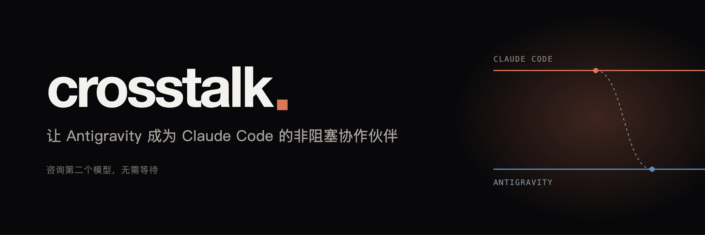

<div align="center">



咨询第二个模型时不必盯着转圈。跨调用保持同一对话线程。把答案送到真正需要它的那个会话。

[](LICENSE)
[](https://code.claude.com/docs)
[](https://antigravity.google)

[English](README.md) · [Español](README.es.md) · 中文

</div>

---

## 问题所在

目前已有的 Claude 到 Gemini 的桥接方案全部是**阻塞式**的。Claude 调用 `agy`，然后所有人一起等——你、模型、终端——等第二个模型花四分钟读完一个代码库。让你付出四分钟真实时间的委托不叫委托，那只是一次很慢的工具调用。

crosstalk 改变的是交互的形态，而不是底层管道：

- **非阻塞。** 调用被放到后台执行。Claude 继续干活，命令结束时会收到通知。答案是你随后处理的一次打断，而不是你必须忍受的一段等待。
- **保持线程。** 每次调用都可以恢复一个具名的 Gemini 对话，因此追问时不必从头重述问题。
- **可路由。** Claude Code 2.1.224 加入了跨会话消息。crosstalk 用上了它：答案可以落在真正需要它的会话里，而不是恰好发起提问的那个。
- **有账可查。** 每次调用都会记账。`stats` 会告诉你到底把多少工作量移出了 Claude 的上下文。

## 与同类项目的对比

前人的工作是实打实的，也值得使用——这个项目并不打算取代全部。

| | crosstalk | [antigravity-for-claude-code](https://github.com/yuting0624/antigravity-for-claude-code) | [claude-code-agy-CLI-skill](https://github.com/SafeMantella/claude-code-agy-CLI-skill) |
|---|---|---|---|
| 委托方式 | 非阻塞 | 阻塞式子代理 | 阻塞 |
| 对话连续性 | 具名线程，可恢复 | 每次调用独立 | 每次调用独立 |
| 跨会话路由 | 有，通过 `SendMessage` | — | — |
| Token 记账 | 账本 + `stats` | — | — |
| 覆盖整个研发周期的模型路由 | — | 有 | — |

如果你想要的是贯穿软件生命周期、有明确主张的模型路由，请用 `antigravity-for-claude-code`；那是个好项目，做的事情 crosstalk 根本没打算做。当你想要的是一个「随时能问、又不必停下来」的伙伴时，再用 crosstalk。

## 安装

```
/plugin marketplace add obeskay/crosstalk
```
```
/plugin install crosstalk@crosstalk
```

必须分两次发送——粘在一起发送会安装失败。

也可以不装插件、只用这个 skill：把 `skills/crosstalk/` 复制到 `~/.claude/skills/` 即可。脚本就放在 skill 目录内，复制这一份就是完整安装。

无论用哪种方式，**装完请开一个新会话**——Claude Code 在会话启动时加载 skills。

## 环境要求

- **Claude Code 2.1.224+**，用于跨会话消息。更早的版本仍可使用非阻塞委托和线程功能，只有路由需要这个版本。仅支持 macOS 和 Linux——原生 Windows 上没有该功能。
- **[Antigravity CLI](https://antigravity.google)**（`agy`）在 `PATH` 中，并已登录。
- **`python3` 或 `node`**，用于解析 `agy` 的 JSON 输出。这两者你的机器上必有其一。

## 使用方式

你不需要自己调用它，直接告诉 Claude：

```
问问 Gemini 这个重试逻辑会不会重复扣款
```
```
让另一个模型看看这个迁移方案，别等它
```
```
让 Gemini 扫一遍仓库里写死的 URL，然后告诉我另一个终端里的那个会话
```

也可以直接用命令行：

```bash
crosstalk.sh ask "这个重试在 429 时会重复扣款吗？" --thread payments
crosstalk.sh ask "那 503 呢？" --thread payments   # 它记得
crosstalk.sh stats
crosstalk.sh threads
crosstalk.sh reset payments
```

参数：`--thread 名称`、`--model M`、`--effort low|medium|high`、`--timeout 时长`（默认 `10m`）。

## 工作原理

```
   你的 Claude 会话                              Antigravity
  ┌────────────────────┐                     ┌───────────────┐
  │  crosstalk skill   │      后台调用        │  agy -p       │
  │                    │ ──────────────────► │  --output-    │
  │  继续干活 ──────────┼─ ─ ─ ─ ─ ─ ─ ─ ─ ─  │    format json│
  │                    │ ◄────────────────── │               │
  └─────────┬──────────┘   结束时通知         └───────────────┘
            │                                        ▲
            │ SendMessage                            │ --conversation <id>
            ▼                                        │
  ┌────────────────────┐                    ┌────────┴────────┐
  │  你的另一个         │                    │   线程状态       │
  │  Claude 会话        │                    │ （本地，明文）    │
  └────────────────────┘                    └─────────────────┘
```

`agy -p --output-format json` 会返回 `conversation_id`、`status`、`response` 和 `usage`。crosstalk 按线程名保存 conversation id，下次调用时用 `--conversation` 传回去——这正是追问变便宜的原因。其余部分全部是 Claude Code 自身的文档化能力：后台 Bash 负责非阻塞，`ListAgents` 和 `SendMessage` 负责路由。

状态保存在 `$XDG_STATE_HOME/crosstalk`（即 `~/.local/state/crosstalk`），只有两样东西：conversation id，以及记录每次调用开销的 JSONL 账本。可用 `CROSSTALK_STATE_DIR` 覆盖。除了发给 `agy` 本身，不会向任何地方发送数据。

## 局限

直说为好，自己踩坑更糟：

- **Gemini 是冷启动的。** 它看不到你未提交的改动、你的对话，也看不到你刚刚敲定的方案。提示词必须能独立成立。这是调用独立 CLI 的固有属性，crosstalk 无法掩盖。
- **跨会话路由需要该功能处于开启状态。** 在 macOS 和 Linux 上自 2.1.224 起默认开启，但接收方会话可能扣留或拒收消息（`crossSessionInbound`），并且部分服务提供方根本不提供该功能。用 `/list-agents` 确认。
- **线程是本地的。** conversation id 存在你这台机器上。换一台机器就是另一套线程。
- **账本记的是 Gemini 的 token，不是你省下的量。** 它告诉你有多少工作被移走了；至于在 Claude 里做这些原本要花多少，两个 CLI 都无法测量。

## 参与贡献

欢迎提 issue 和 PR。请守住范围：这是一座桥，不是一个框架。如果某个改动要引入依赖，它得配得上这份代价。

## 许可证

MIT——见 [LICENSE](LICENSE)。

与 Anthropic 和 Google 均无隶属关系。Antigravity 和 Gemini 是 Google 的产品，Claude Code 是 Anthropic 的产品。
